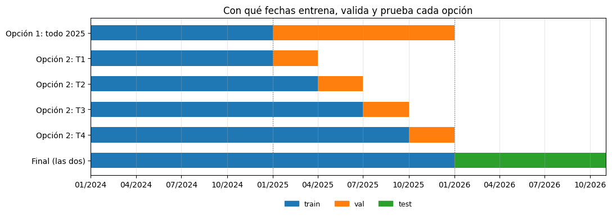

# ¿Se puede anticipar cuántos pasajeros suben a cada ómnibus de Montevideo? Y, sobre todo, ¿cómo saberlo sin engañarse?

**Aprendizaje Automático I. Proyecto final. Grupo 2**
Marco Ariano, Carolina Bonifacino, Valentina Penén, Felipe Yelpo

---

## 1. Problema y pregunta

La demanda de ómnibus en Montevideo cambia con la hora, el día, el clima y los eventos (feriados, clases, elecciones), pero la oferta se programa con horarios fijos. Así aparecen ómnibus llenos en algunas franjas y casi vacíos en otras. El Sistema de Transporte Metropolitano (STM) registra cada subida y la Intendencia publica esos datos, pero no encontramos herramientas públicas que los usen para anticipar la demanda. Si la noche anterior se supiera cuánta gente va a subir a cada línea en cada hora, la Intendencia y las empresas podrían mover flota hacia donde hace falta.

La pregunta es qué tan bien se puede predecir, con un día de anticipación, cuántos pasajeros suben por hora a cada línea urbana de Montevideo, y cuánto mejor es esa predicción que una regla simple. "Con un día de anticipación" quiere decir que para predecir el día D usamos solo lo que se sabe al terminar el día D−1, incluido el pronóstico del clima de ese momento.

A medida que avanzamos apareció una segunda pregunta, que terminó siendo la central. Con datos que avanzan en el tiempo, la forma de separar entrenamiento, validación y test decide qué tan creíble es cualquier número que reportemos. Por eso comparamos dos formas de elegir el modelo y medimos cuál anticipa mejor el error real. Desde el principio aceptamos que la respuesta podía ser que el aprendizaje automático no le gana a una regla simple. Lo importante era poder mostrarlo bien.

---

## 2. Datos

Usamos tres fuentes. Los viajes del STM, del portal de datos abiertos de la Intendencia, con una fila por cada validación de tarjeta o boleto. Un calendario armado por nosotros con feriados, Carnaval, Turismo, elecciones, fin de año, clases de ANEP y paros de transporte. Y el pronóstico del clima de Open-Meteo, que guarda lo que cuatro servicios del tiempo (GFS, ECMWF, ICON y GEM) pronosticaban 24 horas antes. Usamos el promedio de los cuatro.

El período va de enero de 2024 a octubre de 2026, el último mes publicado: 34 meses, 1035 días y 848 millones de pasajeros. Procesamos todo con Spark en Databricks en tres capas: *bronze* con los archivos tal cual, *silver* con tipos correctos y sin filas inválidas ni repetidas, y *gold* con la tabla del modelo. La limpieza casi no descartó nada. No hubo fechas, pasajeros ni líneas inválidas, y las filas repetidas fueron menos del 0,01 %.

Cada fila de gold es una línea, un día y una hora: 136 líneas × 1035 días × 24 horas = 3.378.240 filas. Armamos la grilla completa y pusimos 0 donde nadie subió, porque "0 pasajeros a las 3 de la mañana" es un dato y no un faltante. La suma de pasajeros de gold coincide exacta con la de silver para las líneas incluidas.

Entran las 136 líneas urbanas que anduvieron al menos 100 días en 2024 y en 2025, que llevan el 99,5 % de los pasajeros. Para elegirlas no miramos 2026, porque eso sería usar el test para decidir qué entra al modelo. Los días en que una línea todavía no había arrancado, y su primer mes, tampoco se usan, porque ese 0 no es real.

Todas las variables se conocen la noche anterior. Los *rezagos* son los pasajeros de la misma línea y hora 1, 7, 14, 21 y 28 días antes, el promedio y la mediana de esas cuatro semanas, y el total de la línea el día anterior. Cuando un rezago cae en un día raro (un feriado, el 1° de mayo, un paro) lo cambiamos por la *mediana limpia*, que es la mediana de las semanas que no cayeron en días raros. Hizo falta porque la mediana aguanta una semana rara pero no dos: el 8 de mayo de 2025 miraba el 1° de mayo y el jueves de Turismo, y quedaba en la mitad de lo normal. El *calendario* aporta el día de la semana, el tipo de día de hoy y de ayer (hábil, sábado, domingo, Turismo o feriado), las marcas de días especiales, si hay clases y si cambió el estado de las clases respecto de las cuatro semanas que mira la mediana. El *clima* es el pronóstico hecho 24 horas antes y no el observado, que el día anterior todavía no existe. Ese pronóstico erra la temperatura por 1,65 °C en promedio y pronosticó lluvia en el 12,6 % de las horas, contra un 12,2 % en que llovió de verdad.

Los modelos usan solo las filas *completas*, con todos los rezagos, con pronóstico y con la línea ya en marcha. Las primeras semanas de 2024 no tienen rezago de 28 días ni pronóstico, así que las filas completas empiezan el 29/01/2024. Quedan 1.100.208 filas en 2024 (el 92,1 %), 1.191.360 en 2025 y 992.256 en 2026 (enero a octubre), estas dos últimas al 100 %.

El análisis exploratorio, hecho solo con 2024, marcó el camino del resto del trabajo. Los pasajeros por hora tienen una cola larga (media 256, mediana 69 y un 24 % de horas con 0), por eso algunos modelos predicen log(1 + pasajeros). La forma del día cambia con el tipo de día (un hábil tiene dos picos y un domingo es parejo), o sea que la hora y el tipo de día interactúan. Un hábil con clases lleva un 24 % más de pasajeros que uno sin clases, y con 5 a 20 mm de lluvia pronosticada viaja un 14 % menos de gente. Pero lo más fuerte es que la demanda se repite muchísimo de una semana a otra: la mediana de las cuatro semanas anteriores tiene una correlación de 0,97 con los pasajeros. El rezago de 1 día, en cambio, engaña cuando cambia el tipo de día. Un lunes lleva 2,5 veces los pasajeros del domingo anterior, pero casi lo mismo que la mediana de sus cuatro lunes anteriores.

---

## 3. Cómo dividimos los datos

### 3.1 Por qué no al azar

Las filas no son independientes. Las de un mismo día comparten clima, feriado y nivel de demanda, y los rezagos de un día son los pasajeros de días anteriores. Si mezcláramos días al azar entre entrenamiento y test, el modelo vería el futuro de los días que tiene que predecir y el error saldría artificialmente bajo. Por eso toda división es por fecha: se entrena con el pasado y se evalúa con lo que viene después. Por la misma razón, los intervalos de confianza salen de un *bootstrap por bloques*, que sortea semanas enteras y nunca filas sueltas.

Además, las categorías, el tamaño de cada línea y los perfiles históricos se calculan solo con el entrenamiento de cada caso, el *early stopping* de los árboles está apagado (separa una parte del entrenamiento al azar) y el test se corre una sola vez, después de dejar anotado qué eligió cada opción y qué vamos a mirar.

### 3.2 La división de la propuesta y por qué la cambiamos

En la propuesta planteamos entrenar con enero a setiembre de 2024, validar con octubre a diciembre de 2024 y probar en 2025. Al probar las reglas simples con esa división apareció el problema: el entrenamiento no tenía ningún diciembre. En esa validación, las fiestas de fin de año y las dos elecciones (8 de 92 días) juntaban cerca de un tercio del error de la mejor regla. Un modelo entrenado sin diciembre no puede aprender las fiestas, y una validación de tres meses depende mucho de qué días especiales le toquen. Pasamos entonces a un año entero para cada cosa: 2024 para entrenar, 2025 para validar y 2026 para el test.

### 3.3 Las dos opciones que comparamos

Las dos opciones usan los mismos candidatos, validan en los mismos días (todo 2025), se vuelven a entrenar con 2024 y 2025 y se prueban una sola vez en 2026. Solo cambia con qué datos se entrena el modelo que predice cada parte de 2025 (Figura 1).

| | Opción 1: holdout de un año | Opción 2: validación cruzada temporal |
|---|---|---|
| Cómo se valida 2025 | Un modelo entrenado con 2024 predice todo 2025 | Cada trimestre de 2025 lo predice un modelo entrenado con todo lo anterior |
| Tiempo entre el último día de entrenamiento y el día que predice | Hasta 12 meses | Hasta 3 meses |
| Elección, reentrenamiento y test | Menor MAE en 2025, después 2024 + 2025 → 2026 | Igual |

*Figura 1. Con qué fechas entrena (azul), valida (naranja) y prueba (verde) cada opción.*

La opción 2 es la validación cruzada para series de tiempo con origen móvil y ventana creciente (Tashman, 2000, y Hyndman y Athanasopoulos, 2021). A diferencia de la validación cruzada común, nunca usa el futuro para predecir el pasado (Bergmeir y Benítez, 2012).

La comparación es justa porque las dos validan las mismas filas y tienen el mismo test. En el primer trimestre entrenan con lo mismo y su error coincide exacto, lo que usamos como control. Y como el reentrenamiento final es el mismo, lo único que puede cambiar es qué candidato elige cada una y qué error le prometió.

Para compararlas miramos si eligen el mismo modelo y cuánto se equivoca en 2026 lo que elige cada una. También miramos el *optimismo*: cuánto creció el error al pasar de validación a test, dividido lo que creció el error de la mediana de 4 semanas. La mediana no aprende nada, así que su cambio refleja solo que 2026 es distinto de 2025, y un optimismo mayor que 1 quiere decir que la validación prometió menos error del que hubo. Antes de prender el test vimos que con eso no alcanzaba, porque las dos opciones eligieron el mismo modelo con casi el mismo error de validación (sección 5.1). Por eso agregamos, también antes de ver el test, tres análisis más: cuánto se equivoca cada opción al anticipar el error de test de los 13 candidatos, la misma comparación usando solo los meses de 2025 que tiene el test (enero a octubre) y el test sin los días de paro, porque marcar o no un paro de 2026 depende de cómo lo contaron las noticias.

---

## 4. Reglas simples y modelos

Las reglas simples casi no aprenden. La *mediana de 4 semanas* usa la mediana de la misma línea y hora 7, 14, 21 y 28 días antes. El *perfil histórico* usa el promedio del entrenamiento para la misma línea, hora y tipo de día. La *regla por tipo de día* usa el perfil en feriados y Turismo y la mediana el resto de los días, porque cada una falla donde la otra acierta. Es la mejor de las tres.

Los candidatos que aprenden son 13, todos con scikit-learn (Pedregosa et al., 2011). Diez son *regresiones Ridge* sobre log(1 + pasajeros). Usan cuatro rezagos en logaritmo (mediana limpia, 1 día, 7 días y total del día anterior), porque los demás tienen correlaciones de 0,95 a 1 entre sí. El rezago de 1 día entra solo cuando ayer fue el mismo tipo de día que hoy, y aparte va el cambio de tipo de día (por ejemplo "domingo a hábil"). También entran el calendario, el pronóstico (la lluvia en logaritmo) y la hora, el tipo de día y el tipo de línea como categorías. Probamos cinco penalizaciones (α de 1 a 10⁶), con y sin la interacción hora × tipo de día.

Los otros tres son *árboles con boosting* (HistGradientBoosting, 63 hojas, 200 iteraciones), que combinan variables solos, algo que una regresión no hace. Ven todos los rezagos y también la línea como categoría. Hay una versión con pérdida de Poisson, pensada para conteos, otra sobre log(1 + pasajeros) y una *residual*, que aprende cuánto corregir la mediana limpia.

Los árboles van sin ajustar. Las tres versiones usan las mismas perillas (63 hojas, 200 iteraciones, tasa de aprendizaje 0,1 y al menos 100 filas por hoja), y la validación solo elige entre las tres familias. Con la Ridge, en cambio, probamos diez combinaciones. Lo hicimos así por tiempo, porque en la opción 2 cada candidato se entrena cuatro veces y una grilla chica de árboles multiplicaba las horas de cálculo. Esto no le da ventaja al árbol, al revés: si con perillas elegidas a ojo ya le gana a la mejor Ridge, ajustado probablemente le ganaría por lo mismo o por más. Donde sí pesa es en la comparación de las dos formas de validar, porque con pocos candidatos de árbol hay poco para elegir.

La métrica principal es el MAE en pasajeros por hora. La *mejora* es 1 − MAE del modelo / MAE de la referencia, así que 0,10 quiere decir un 10 % menos de error. No usamos R², porque todas las reglas que miran semanas anteriores dan cerca de 1. Los intervalos son del 95 %, con 1000 réplicas sorteando semanas, las mismas para todos los modelos, así que el intervalo de la mejora dice si un modelo le gana de verdad a otro.

---

## 5. Resultados

### 5.1 Validación (2025)

| | Opción 1 | Opción 2 |
|---|---|---|
| Modelo elegido | `hgb_poisson_h63` | `hgb_poisson_h63` |
| MAE [IC 95 %] | 26,6 [24,8 a 28,7] | 26,6 [24,8 a 28,7] |
| Mejora sobre la mediana | 33,2 % [26,0 a 40,3] | 33,2 % [26,1 a 40,0] |
| Mejora sobre la regla por tipo de día | 23,7 % [18,7 a 28,9] | 23,8 % [19,1 a 28,7] |
| MAE de la mejor Ridge | 30,6 | 31,4 |
| Mejora del árbol sobre la mejor Ridge | 13,1 % [10,2 a 16,0] | 15,5 % [12,6 a 18,4] |

Como referencia, la mediana de 4 semanas tiene un MAE de 39,7 y la regla por tipo de día de 34,8. El árbol elegido y las mejores regresiones le ganan a las dos, y los intervalos de la mejora no tocan el 0.

Las dos opciones eligen el mismo modelo, el árbol con pérdida de Poisson, y los puestos casi no cambian (solo se dan vuelta dos regresiones que están a menos de una décima). Los controles dan bien: en el primer trimestre el error de las dos es idéntico y las Ridge de la opción 1 coinciden con el notebook 06 hasta el último decimal.

Los árboles le ganan a todas las regresiones, y la tabla por tipo de día muestra dónde.

| MAE por tipo de día (opción 1) | Hábil | Sábado | Domingo | Turismo | Feriado |
|---|---|---|---|---|---|
| Mediana de 4 semanas | 38,5 | 25,2 | 21,6 | 122,9 | 211,6 |
| Regla por tipo de día | 38,5 | 25,2 | 21,6 | 49,7 | 51,7 |
| Mejor Ridge | 33,1 | 24,0 | 21,4 | 52,0 | 32,7 |
| Árbol elegido | 29,0 | 22,3 | 18,8 | 27,4 | 26,8 |

La mediana anda bien en días comunes y muy mal en feriados y Turismo, porque las semanas anteriores fueron normales. La regresión arregla los feriados, pero en Turismo no le gana a la regla, porque solo puede sumar efectos y ahí hay que combinar la línea, la hora y el tipo de día. Eso es justo lo que hacen los árboles.

Entrenar con los meses de 2025 ya pasados (opción 2) no ayudó. Las regresiones útiles se equivocan entre 0,4 y 2,4 pasajeros por hora más de abril a diciembre, y en los árboles la diferencia queda en más o menos 0,3, que es ruido. Creemos que es porque el nivel de cada línea ya entra por los rezagos, así que el modelo se adapta solo, y lo que aprende del entrenamiento (cómo pesan la hora, el tipo de día y los feriados) casi no cambió de 2024 a 2025. Las regresiones con α de 10⁵ y 10⁶ sí mejoran con la opción 2, pero porque con más filas el mismo α castiga menos.

Ridge no sobreajusta: su error en entrenamiento y en validación es casi el mismo (30,5 y 30,6) y con α de 1 a 10⁴ casi no cambia (de 30,6 a 31,1). Para mejorar hace falta más información, no más datos del mismo tipo. Los días que siguen costando son la primera semana de enero, cuando la gente se va de vacaciones y ninguna variable lo marca, y el paro del 31/07/2025, en el que cada empresa salió con una cantidad distinta de ómnibus.

### 5.2 Test (2026, enero a octubre)

[Completar después de correr el test.]

| | Opción 1 | Opción 2 |
|---|---|---|
| MAE en test [IC 95 %] | | |
| Mejora sobre la mediana [IC 95 %] | | |
| Mejora sobre la regla por tipo de día [IC 95 %] | | |
| Optimismo | | |
| Error al anticipar a los 13 candidatos (`diferencia_pct`) | | |
| Spearman entre puestos de validación y de test | | |

---

## 6. Conclusiones

[Completar después del test, respondiendo en este orden: si el aprendizaje automático sirve para este problema, si cambia algo la forma de validar y qué recomendamos.]

Hay cosas que este trabajo no puede responder. Tenemos un solo año de test y llega hasta octubre, así que no incluye noviembre ni diciembre. Por eso miramos la mejora sobre las reglas en los mismos días y no solo el MAE. Hay pocos feriados, elecciones y días especiales por año, y en 2026 no hubo elecciones. Los candidatos son pocos: 10 regresiones que solo cambian en la penalización y la interacción, y 3 árboles sin ajustar (sección 4). Con candidatos más variados la forma de validar podría pesar más. Algunas variables (la mediana limpia, el salto de clases y los paros) las agregamos después de mirar errores de 2025, así que la validación sale un poco optimista para las dos opciones, y el error de verdad lo da el test. Por último, los datos solo registran quién subió y no quién se quedó esperando porque el ómnibus venía lleno.

Trabajamos todo en Databricks Free Edition, con Spark, porque los viajes descomprimidos pasan los 90 GB y ahí corre mucho más rápido que en nuestras computadoras. El código está en un repositorio privado de GitHub (https://github.com/carob05/Trabajo-Aprendizaje-Automatico-I). Para reproducirlo se puede entrar a nuestro workspace, donde ya están las tablas, el código y los notebooks corridos (hay que pasarnos el correo de la cuenta de Databricks), o armarlo desde cero pidiéndonos acceso al repositorio y bajando los datos a mano. Los pasos de las dos formas están en el README del repositorio.

---

## Referencias

- Bergmeir, C. y Benítez, J. M. (2012). On the use of cross-validation for time series predictor evaluation. *Information Sciences*, 191, 192-213.
- Hyndman, R. J. y Athanasopoulos, G. (2021). *Forecasting: principles and practice* (3.ª ed.). OTexts. https://otexts.com/fpp3/
- Intendencia de Montevideo. Viajes realizados en los ómnibus del Sistema de Transporte Metropolitano - STM. Portal de datos abiertos. https://ckan.montevideo.gub.uy/dataset/viajes-realizados-en-los-omnibus-del-sistema-de-transporte-metropolitano-stm
- Open-Meteo. Previous Model Runs API. https://open-meteo.com/en/docs/previous-runs-api
- Pedregosa, F. et al. (2011). Scikit-learn: Machine learning in Python. *Journal of Machine Learning Research*, 12, 2825-2830.
- Tashman, L. J. (2000). Out-of-sample tests of forecasting accuracy: an analysis and review. *International Journal of Forecasting*, 16(4), 437-450.
- Las fuentes de cada fecha del calendario (feriados, clases y paros) están en `src/bondis/calendario.py`.
